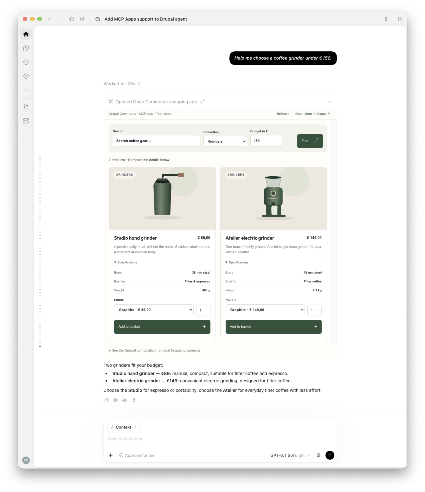
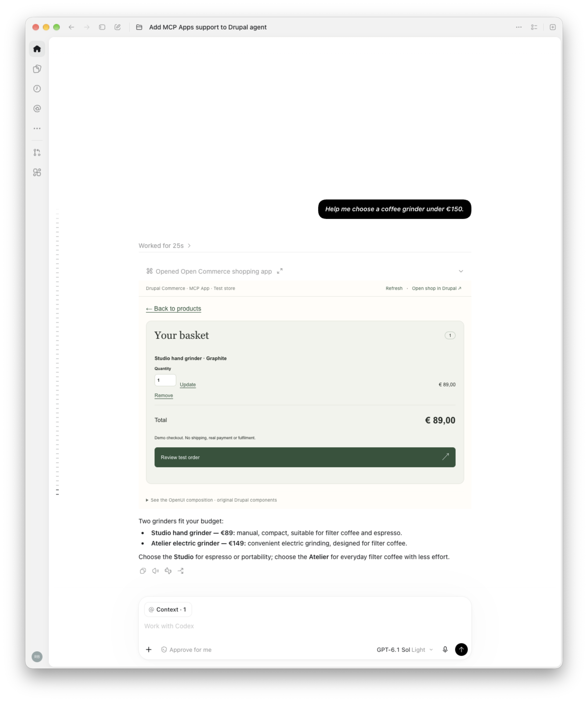
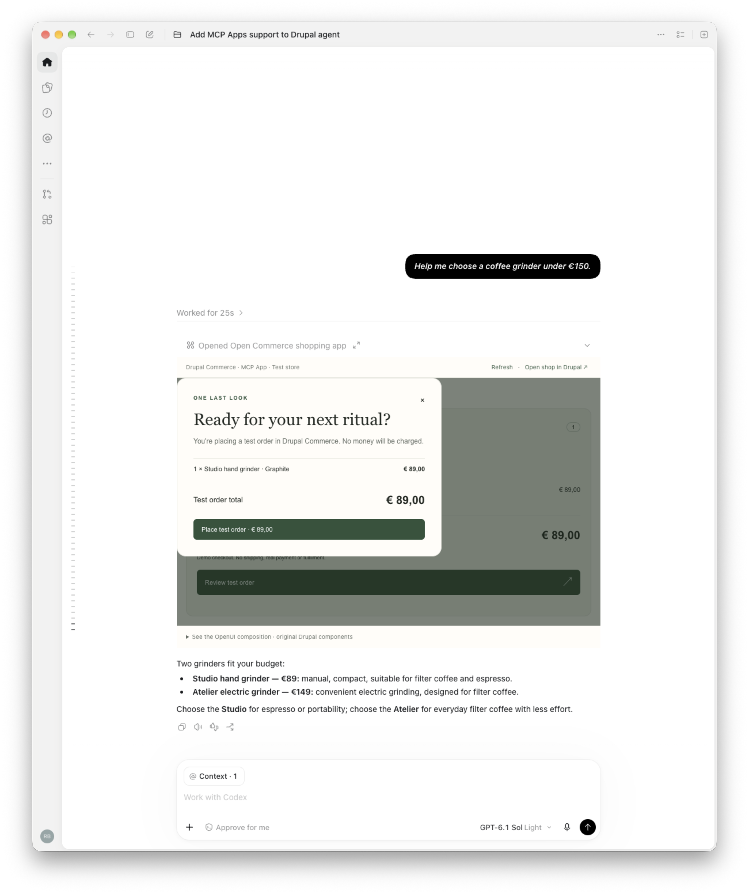
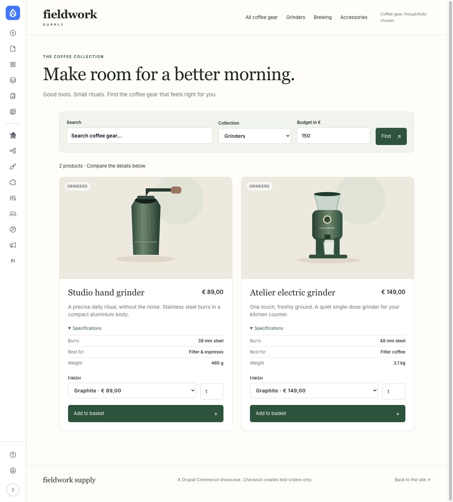

In my previous post about [MCP Apps in Drupal](/blog/mcp-apps-drupal-tool-api/), I explored how Drupal tools can be reused across different interfaces.

[Tool API](https://www.drupal.org/project/tool) lets Drupal define an operation once. A normal Drupal interface can use it, a workflow can use it, and an external agent can reach it through [MCP Server](https://www.drupal.org/project/mcp_server).

[MCP Apps](https://modelcontextprotocol.io/extensions/apps/overview) adds an interface for cases where text is not enough. A tool can provide an interactive application that a supporting MCP host renders alongside the conversation.

In that first demo, Drupal provided the tools for finding an article, searching Media and saving a new hero image. The app added the visual step I needed to compare the images and make a choice.

While working on that, another question started nagging me: if the tools can be reused, what about the components?

## If tools can be reused, what about components?

That question also took me back to [DrupalCon Rotterdam](https://www.drupal.org/blog/driesnote-rotterdam).

The [Canvas demos](https://www.drupal.org/blog/proof-not-promises-watch-the-six-demos-from-the-driesnote-rotterdam) showed components becoming a larger part of how Drupal sites are built. Code Components gave JavaScript developers another way to build them, while Canvas Headless showed Drupal's editing experience connected to applications outside the normal Drupal frontend.

Drupal already has [Single Directory Components](https://www.drupal.org/docs/develop/theming-drupal/using-single-directory-components). An SDC keeps its prop schema, Twig template and attached CSS and JavaScript together.

I hadn't worked much with these parts of Drupal before, and my front-end skills are not the best, but I wanted to try something fairly specific.

If a component already exists in Drupal, could an MCP App use it too?

I wanted Drupal to render the original component and let the app show that result. Maintaining another copy of its template and styling would take away much of the reason for doing this.

## Let Drupal render the component

An SDC describes what a component accepts. It can define props such as a title, image, price or list of data, and named slots that contain other components.

That gives us something useful to expose: the component ID, its supported props and the slots it can fill. Drupal still has the schema and rendering code needed to check the composition and produce the interface.

The adapter discovers components through Drupal's component manager, builds normal `#type: component` render arrays and renders their original Twig templates. It also collects the assets attached to that output.

There is no React version of the product card, basket or other Drupal components in this demo.

## Where OpenUI fits

For this proof of concept, I am using [OpenUI](https://www.openui.com/docs/openui-lang/renderer).

OpenUI lets an application define a component library and parse compositions that refer to those components. My integration gives it a `DrupalComponent` wrapper around supported SDCs discovered by Drupal.

A small composition could look like this:

```text
root = Page([
  DrupalComponent(
    "mcp_apps_commerce_demo:basket_summary",
    {
      "count": 1,
      "total": "€89.00"
    },
    {}
  )
])
```

This only shows the composition format. In the shopping flow, Drupal supplies the item count and formatted total from Commerce. The app does not treat a model-generated price as authoritative.

`Page` is the container used by the OpenUI integration. It does not create a Drupal or Canvas page. The third argument to `DrupalComponent` holds named slots, which can contain more components.

OpenUI's parser and React renderer handle the composition wrapper. Drupal validates the resulting tree and renders the actual components. React handles the app shell and host connection.

The general SDC integration can accept an OpenUI program created by the agent. For the Commerce demo, I use a more controlled flow: the agent chooses filters and a mode, and Drupal builds the composition from the tool results.

I still do not think every interface needs the model to assemble it.

## Demo time!

For the demo, I built a small coffee-gear shop called Fieldwork Supply with [Drupal Commerce](https://www.drupal.org/project/commerce).

The products and branding are fictional, but they are real Commerce product and variation entities. Commerce resolves the prices, adding a product updates a Commerce cart, and the test checkout can create a completed order with a simulated payment.

In Codex, I can ask:

> Help me choose a coffee grinder under €150. Show the shopping app.

That opens two matching grinders: an €89 hand grinder and a €149 electric grinder. Their specifications are visible immediately, so I can compare them without first selecting both products.



*The Drupal Commerce MCP App running inside Codex, opened from the coffee-grinder request. Drupal renders both product cards and their specifications.*

The agent can request `mode: choose` to show the specifications immediately, or `mode: browse` for a normal catalog with manual comparison. The default `auto` mode expands the details when there are two or three matching products.

The tools and components stay the same, while the initial interface follows what I asked for.

## What calls what?

The shopping demo adds four Tool API adapters around Commerce:

- `commerce_demo_catalog` returns accessible products, variations, resolved prices and specifications.
- `commerce_demo_cart` returns the authenticated customer's basket.
- `commerce_demo_cart_update` changes an item's quantity through Commerce's Cart Manager.
- `commerce_demo_checkout` places a reviewed test order through the dedicated simulated gateway.

These operations can be used without the app. I wrote the adapters and the mapping into component props, while Commerce supplies the pricing, availability, cart and payment services underneath them.

The app opens through `commerce_shop_open`, exposed by the bridge as `tool_api__commerce_shop_open`:

```text
Agent calls commerce_shop_open with filters and a mode
    ↓
Drupal invokes the Commerce adapters through Tool API
    ↓
Drupal maps the results into SDC props and slots
    ↓
The app describes and parses that composition with OpenUI
    ↓
The app requests a native preview through the MCP host
    ↓
Drupal validates and renders the original SDCs and assets
    ↓
The app displays the result
```

The open tool points to `ui://drupal/commerce-shop`. MCP Server serves that application to a supporting host, which loads it inside its sandbox.

The rendered HTML and assets travel as app presentation data. The model receives a smaller structured result, such as the number of matches and basket total.

## From choosing a product to reviewing a basket

The demo uses six module-owned SDCs: `shop`, `product`, `comparison`, `basket_summary`, `basket` and `receipt`.

I can choose a finish, add a product and continue from a compact basket summary. The full basket is a separate step, so it does not compete with the product comparison for the limited space inside a conversation.

The basket component contains the quantity controls and order total. Going back to the products keeps the filters and comparison context. Reviewing the test order opens a confirmation step before the final action.



*The Commerce basket inside the same MCP App in Codex, with one €89 Studio hand grinder selected.*



*The test-order review dialog inside Codex, before the final action. The demo gateway cannot charge real money.*

These are normal Drupal components. Their attached JavaScript handles the controls on the website and in the app. The app connects those actions to a small allowlisted set of tool calls through the host.

## Interactions without another model call

The model starts the flow. It does not need to decide what to do every time I change a finish, adjust the budget or update a quantity.

Changing a filter calls an app-only tool through the MCP host. Drupal invokes the catalog operation through Tool API, rebuilds the composition and renders the updated components. Basket updates use the reusable cart operation in the same way.

Choosing a finish updates the shown price locally. Adding that variation still goes back to Drupal, where Commerce resolves the price and checks availability. The value shown by the browser is not the authority for changing the cart.

The basket and product views share the same session state. Moving between them does not require another conversation with the model.

## The same components on the website

The shop is also available as a normal Drupal page at `/shop`.



*The same product SDCs on the Drupal website, with Grinders, a €150 budget and choice mode selected. The surrounding page layout belongs to the site's theme.*

Both surfaces use the same Tool API operations, component mapping, Twig templates and attached component assets. The app receives a Drupal-rendered preview, while the website puts the render array into a normal page.

Their surrounding layouts are different. The website has the site's navigation and page wrapper, while the app has its host and compact controls.

The basket is also shared when both connections use the same Drupal account. It is not copied into a separate app store.

## Where the different protocols fit

I had to untangle how [MCP Apps](https://modelcontextprotocol.io/extensions/apps/overview), [AG-UI](https://docs.ag-ui.com/introduction), OpenUI and [A2UI](https://a2ui.org/) relate.

MCP Apps lets the Drupal server provide an application that a supporting host can render inside the conversation. The host owns the surrounding interface, sandbox and connection. Support still differs between clients.

AG-UI defines the events exchanged between an agent backend and a user-facing application. It is useful when building and controlling that frontend. Here, Codex already supplies the surrounding interface.

OpenUI and A2UI describe interfaces using known components. OpenUI provides the composition language and parser used in this adapter. A2UI uses declarative messages that a client maps to its component library.

For this proof of concept, MCP Apps brings the interface into Codex and OpenUI connects that interface to Drupal components.

## Access and checkout still belong to Drupal

The app calls the tools with the OAuth identity behind the MCP connection. Drupal checks permissions, entity and field access, Commerce availability and cart ownership.

Opening the website is a separate browser login. The app's OAuth token does not sign that browser into Drupal, so that handoff still needs a friendlier login experience.

Checkout is deliberately limited to the demo. The dedicated gateway works only in test mode and records a simulated payment. No real money is charged, no receipt email is sent and no delivery starts.

Before placing a test order, Drupal refreshes the prices and checks the basket revision that was reviewed. If the total changed, the user must review it again.

A production checkout would need the storefront's configured payment gateways, addresses, shipping and checkout behaviour. Those are outside this experiment.

## Current boundaries

I am still treating this as a proof of concept.

The SDC adapter supports JSON-compatible props and supported local attached assets. It reports schemas and references it cannot represent, and rejects external assets and private files.

Component JavaScript can run inside the preview's sandbox. The Commerce controls use explicit JavaScript handlers and an allowlisted tool map.

OpenUI state, Query and Mutation expressions are not supported by this first adapter.

For the Commerce demo I mapped the tool results to a known set of shop components myself. Automatic binding between any Tool API result and any SDC is not part of this yet.

The demo also does not create or edit Canvas pages.

## Contributing back

This proof of concept builds on the [Drupal MCP Apps repository](https://github.com/ronaldtebrake/drupal_mcp_apps) and the [Agent Access](https://www.drupal.org/project/agent_access) recipe for the OAuth and MCP connection.

The reusable OpenUI integration is separate from the optional Commerce demo. Other modules should be able to provide their own tools and components without depending on a coffee shop.

The demo uses pinned patches for three contributions:

- [MCP Server MR !89](https://git.drupalcode.org/project/mcp_server/-/merge_requests/89), which adds MCP Apps extension registration and preserves tool and resource metadata.
- [Tool API MR !206](https://git.drupalcode.org/project/tool/-/merge_requests/206), which adds generic metadata to tool definitions and execution results.
- [MCP Server Tool Bridge MR !28](https://git.drupalcode.org/project/mcp_server_tool_bridge/-/merge_requests/28), which forwards the MCP metadata namespace into MCP definitions and results.

I also used Codex while building this. It helped with the module code, tests, documentation, contribution patches and this post. I reviewed the changes, tested the result and submitted the upstream work myself.

The fictional product illustrations were also created with Codex assistance and are included with the module under GPL-2.0-or-later. OpenUI is MIT licensed, and the repository retains its bundled dependency notices.

## Where this leaves me

The shopping demo gives me the answer I was looking for, at least for this example.

The operations go through Tool API, Commerce handles the products, prices, basket and test order, and Drupal renders the SDCs. I can use those operations and components on the website and inside the MCP App.

There is still more to work out. The mapping between the tool results and components is explicit, and the browser login handoff is unfinished. I do not know yet what the right Drupal approach is for mapping more kinds of tool results to components.

That brings me back to the [Rosetta Sprint](https://www.drupal.org/blog/driesnote-rotterdam).

The goal of the sprint is to describe Drupal's capabilities once, in a form that agents, other systems and people can all use. If that works, new integrations should be able to use those capabilities without describing everything again.

Components are not necessarily part of that same description, but this experiment makes the connection hard to ignore and helped me with my mental model.

MCP Apps are only one place where these capabilities and components can be used. The same capability might be reached through a Drupal form, a workflow, a headless frontend, an agent or another system. The [One surface, every door](https://mlander.github.io/data_surface/every-door/#side-by-side) example shows the wider idea well: a form, a React page and an agent can all read the same contract instead of describing the same inputs again.

If Drupal can describe both what it can do and which components it can render, we are setting ourselves up for a much more composable system. New interfaces can reuse the capability, its contract and parts of the interface, instead of starting over each time.

I am looking forward to the Rosetta Sprint because it is a chance to bring experiments like this together and find out which of those pieces Drupal can describe and reuse more consistently.

## References

- [Drupal MCP Apps proof of concept](https://github.com/ronaldtebrake/drupal_mcp_apps)
- [MCP Apps OpenUI integration](https://github.com/ronaldtebrake/drupal_mcp_apps/blob/main/modules/mcp_apps_openui/README.md)
- [MCP Apps overview](https://modelcontextprotocol.io/extensions/apps/overview)
- [OpenUI renderer](https://www.openui.com/docs/openui-lang/renderer)
- [AG-UI](https://docs.ag-ui.com/introduction)
- [A2UI](https://a2ui.org/)
- [Single Directory Components](https://www.drupal.org/docs/develop/theming-drupal/using-single-directory-components)
- [Drupal Commerce](https://www.drupal.org/project/commerce)
- [Tool API](https://www.drupal.org/project/tool)
- [MCP Server](https://www.drupal.org/project/mcp_server)
- [Data surfaces](https://www.drupal.org/project/drupal/issues/3622144)
- [One surface, every door](https://mlander.github.io/data_surface/every-door/#side-by-side)
- [DriesNote Rotterdam](https://www.drupal.org/blog/driesnote-rotterdam)
- [Proof, not promises: the six DriesNote demos](https://www.drupal.org/blog/proof-not-promises-watch-the-six-demos-from-the-driesnote-rotterdam)
- [Agent Access](https://www.drupal.org/project/agent_access)
- [MCP Server MR !89](https://git.drupalcode.org/project/mcp_server/-/merge_requests/89)
- [Tool API MR !206](https://git.drupalcode.org/project/tool/-/merge_requests/206)
- [MCP Server Tool Bridge MR !28](https://git.drupalcode.org/project/mcp_server_tool_bridge/-/merge_requests/28)
